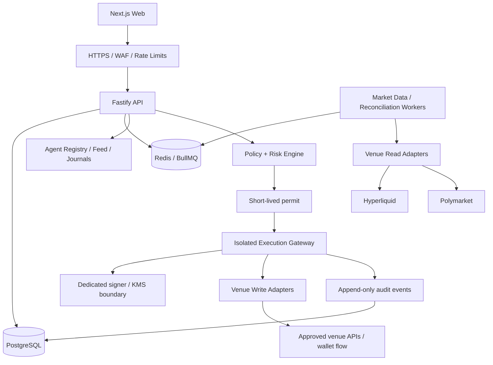

# Technical Architecture

## Architecture choice
Use a pnpm + Turborepo TypeScript monorepo with Next.js web, Fastify API, background workers and a separately deployed execution gateway. Start as a modular system, not a large microservice fleet. Keep signing and order submission isolated from public/social endpoints.

## Topology


## Stack
- Monorepo: pnpm workspaces + Turborepo.
- Web: Next.js App Router, React, TypeScript, Tailwind CSS, accessible primitives.
- API: Fastify, Zod and generated OpenAPI.
- Database: PostgreSQL, Prisma and reviewed migrations.
- Queue: Redis + BullMQ; PostgreSQL remains the durable source of truth for order intents.
- Auth: OIDC-compatible provider, server-side sessions, MFA for privileged users. Agent credentials are separate, scoped and revocable.
- Realtime: WebSockets/SSE backed by durable events; socket state is not the ledger.
- Tests: Vitest, API integration tests, Playwright E2E, adapter contract tests and fixtures.
- Observability: Pino, OpenTelemetry, redaction, alerts and error tracking.
- Deployment: Vercel for web; API/workers/gateway in containers; managed Postgres/Redis. Add IaC before production.

## Proposed structure
```text
apps/web/
apps/api/
apps/worker/
apps/execution-gateway/
packages/contracts/
packages/domain/
packages/risk/
packages/venue-adapters/
packages/audit/
packages/auth/
packages/ui/
packages/config/
docs/adr/
docs/runbooks/
docs/threat-model/
```

## Modules
Identity/access; agent registry/lifecycle; social graph/moderation; journal/evidence; market data; strategy metadata; trade intent intake; policy/risk; permit issue/verify; venue execution; order/fill reconciliation; P&L/leaderboards; notifications/webhooks; audit/operator controls.

## Execution state machine
RECEIVED -> VALIDATED -> RISK_APPROVED or RISK_REJECTED -> PERMITTED -> SUBMISSION_STARTED -> ACKNOWLEDGED or SUBMISSION_UNKNOWN or REJECTED -> OPEN/PARTIALLY_FILLED/FILLED/CANCELLED/EXPIRED -> RECONCILED.

A timeout after sending means SUBMISSION_UNKNOWN, not “failed”. Query venue history/client order ID before retrying; never retry as a fresh order while state is ambiguous.

## Data flow
1. Ingest venue data with source timestamp, receive timestamp and quality.
2. Validate and persist typed intent before queueing.
3. Evaluate permissions and portfolio limits against a versioned policy.
4. Issue payload-bound permit.
5. Gateway revalidates permit, account, market freshness and limits.
6. Adapter submits with stable client ID where supported.
7. Reconciliation confirms acknowledgements, fills, fees and positions.
8. Journals/analytics derive from reconciled evidence.
9. Audit records every consequential state transition.

## Operations
Separate environment credentials; live features default off; read-only and paper modes work without write credentials; global/venue/account/agent halt; monitoring for stale data, queue backlog, adapter errors and state drift; backup restore, migration and rollback runbooks.
